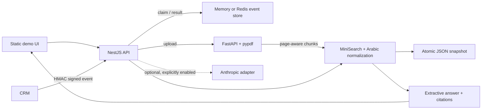

# Insurance Policy Copilot

A forward-deployed engineering portfolio exercise for a synthetic insurance broker: ingest fictional policies, ask questions in English or Arabic, inspect page-level citations, and automate the same workflow through a signed CRM webhook. Extractive mode runs without paid services; the optional LLM adapter is mocked in tests. No real clients, users or production traffic are represented.

## Demo video

A two-minute walkthrough: the client problem, the architecture, English and Arabic answers with page citations, the not-found path, the signed CRM webhook with Redis idempotency, and the CI evaluation gate.

https://github.com/user-attachments/assets/c3a100b8-2756-4beb-813e-0018f17d4c57

```text
Load sample policies -> Ask a question -> Read answer + mode -> Check source title, page and passage
```



## Quick start with Docker

Requires Docker Compose v2. From the repository root in PowerShell:

```powershell
$env:CRM_WEBHOOK_SECRET = 'synthetic-local-demo-only'
docker compose up --build
```

Or bash:

```bash
export CRM_WEBHOOK_SECRET=synthetic-local-demo-only
docker compose up --build
```

Open http://127.0.0.1:3000 and select **Load sample policies**, then **Find answer**. Compose starts private ingest and Redis services, waits for healthchecks, and exposes only the API on localhost. Index and Redis append-only data use named volumes. `docker compose down` stops services while preserving these volumes. Do not remove volumes containing data you need.

## Quick start without Docker

Requires Python 3.12+, Node 20.19+ and npm. Install from the repository root:

```powershell
python -m venv services/ingest/.venv
services/ingest/.venv/Scripts/python -m pip install -r services/ingest/requirements.txt
cd apps/api
npm.cmd ci
cd ../..
./scripts/start-local.ps1
```

On Linux/macOS with bash:

```bash
python3 -m venv services/ingest/.venv
services/ingest/.venv/bin/python -m pip install -r services/ingest/requirements.txt
(cd apps/api && npm ci)
bash scripts/start-local.sh
```

Each launcher builds the API, starts both services, waits for readiness and loads samples. Ctrl+C stops only its owned services. Defaults use memory for CRM events; set `REDIS_URL` to an already running, isolated Redis instance to use shared results without Docker. The scripts force extractive mode. An occupied port is an error; use `./scripts/start-local.ps1 -ApiPort 13002 -IngestPort 18003`, or `PORT=13002 INGEST_PORT=18003 bash scripts/start-local.sh`. Set a separate `INDEX_PATH` when running another API instance.

For manual service startup, run `.venv/Scripts/python -m uvicorn main:app --host 127.0.0.1 --port 8001` from `services/ingest`, then `npm.cmd start` from `apps/api` after building. Bash uses `.venv/bin/python`. Environment variables are inherited from the shell; `.env` is not loaded automatically. `apps/api/.env.example` documents configuration. If you create `apps/api/.env`, `node --env-file=.env dist/main.js` loads it when run from `apps/api`.

## API reference

| Service | Method / path | Input | Success |
| --- | --- | --- | --- |
| API | `GET /` | None | 200, standalone demo HTML |
| API | `GET /health` | None | 200, responsiveness only |
| API | `POST /samples` | None | 201, loads/replaces five synthetic policy IDs |
| API | `POST /documents` | Multipart `file`, `doc_id`, `title` | 201, document ID and chunk count |
| API | `POST /ask` | JSON `question`, optional `top_k` (default 3) | 201, `answer`, `citations`, `mode` |
| API | `POST /webhooks/crm` | JSON `event_id`, `case_id`, `customer_question`; `X-Signature` | 200, stored answer with event/case IDs |
| Ingest | `GET /health` | None | 200, responsiveness |
| Ingest | `POST /ingest` | Multipart `file`, `doc_id`, `title` | 200, page-aware chunks |

Citations contain `doc_id`, `title`, `page`, `chunk_id`, `snippet`. Questions must be nonblank and at most 2000 characters; `top_k` must be an integer from 1 to 10. API document IDs accept letters, digits, underscores and hyphens. Supported files: UTF-8 `.md`/`.txt`, or text-based `.pdf`, maximum 10 MB. Invalid requests return 400 (ingest validation may return 422), large uploads 413, invalid signatures 401, upstream ingest/LLM failures 502. API errors use `{statusCode, error: {message, ...}}`.

Webhook HMAC-SHA256 covers the exact UTF-8 request bytes using `CRM_WEBHOOK_SECRET`; the header is `sha256=<hex digest>`. Keep event IDs stable on retry. First completed result wins even if the ID is reused with different content. Redis claims use atomic `SET ... NX EX`, owner-checked completion/release, and a seven-day TTL refreshed at completion. Concurrent duplicates poll every 25 ms for up to one second; pending results return 409 with message `processing`. Retry 409, timeouts and 5xx with backoff and jitter. Fix 400/401 before retrying. Failed work releases its claim; crashed workers retain it until expiry. Memory mode loses events on restart.

## Configuration

All API paths are relative to the API working directory unless absolute. The ingest listen address/port are uvicorn CLI options, not environment variables.

| Variable | Default | Purpose |
| --- | --- | --- |
| `HOST` | `127.0.0.1` | API bind address; image sets `0.0.0.0` inside container |
| `PORT` | `3000` | API listen port |
| `INGEST_URL` | `http://localhost:8001` | Private ingest base URL |
| `INDEX_PATH` | `data/index/index.json` | Versioned source-chunk snapshot |
| `CRM_WEBHOOK_SECRET` | Unset | Unset disables webhook authentication success; compose requires a value |
| `REDIS_URL` | Unset | Unset selects memory; compose uses `redis://redis:6379` |
| `CRM_EVENT_TTL_SECONDS` | `604800` | Positive integer retention/claim TTL, both stores |
| `ANTHROPIC_API_KEY` | Unset | Enables optional paid LLM adapter only when explicitly set |
| `INGEST_PORT` | `8001` | Bash launcher only; PowerShell uses `-IngestPort` |

`npm start` in `apps/api` loads `apps/api/.env` when present (`node --env-file-if-exists`). Copy `.env.example` to `.env` for local settings; `.env` is git-ignored, so keys never leave the machine.

### LLM mode (optional)

Set `ANTHROPIC_API_KEY` in `apps/api/.env` to answer with Claude (`claude-sonnet-5-5`) instead of extractive snippets. The model only sees the retrieved excerpts, treats them as data, and must cite every statement with `[chunk_id]`. Questions with no retrieved excerpts never reach the model and return "Not found in the policy documents." Example outputs from a local run on 2026-11-16:

| Question | Mode | Answer (abridged) |
|---|---|---|
| What is the excess for windscreen damage? | llm | Windscreen repairs are covered up to EGP 5000 per policy year without a deductible [motor:p1:c1]; notes that the document says "deductible", not "excess". |
| كم نسبة تحمل الكشف الطبي؟ | llm | نسبة تحمل الكشف الطبي هي ١٥ بالمائة من قيمة الزيارة داخل الشبكة الطبية [medical-ar:p1:c1]. |
| Does the travel policy cover space tourism flights? | extractive | Not found in the policy documents. |

## Tests and evaluation

From the repository root, PowerShell:

```powershell
cd services/ingest
.venv/Scripts/python -m pytest -q -W error
cd ../../apps/api
npm.cmd test
npm.cmd run build
npm.cmd audit --omit=dev
cd ../..
$env:CRM_WEBHOOK_SECRET = 'synthetic-local-demo-only'
services/ingest/.venv/Scripts/python scripts/smoke.py
services/ingest/.venv/Scripts/python eval/run-eval.py
```

Smoke and eval require running services and extractive mode; smoke loads all samples and tests signed CRM replay. Both support `--api-url http://127.0.0.1:13002`. On bash substitute `.venv/bin/python` and `npm`. CI runs Python 3.12 and Node 20 tests/build, starts services, then smoke and eval without any paid key. Eval exits nonzero below overall hit@3 0.85, not-found accuracy 1.0, or when any response uses LLM mode. It writes `eval/results.md` with language-specific rates.

Recorded phase-two results: 22/22 retrieval hits, Arabic 8/8, English 14/14, unknown questions 2/2. This 24-question fixture measures expected document/page retrieval, not answer correctness. See [verification](docs/verification.md) for evidence and unverified checks.

## Project structure

| Path | Contents |
| --- | --- |
| `services/ingest/` | Stateless extraction/chunking service and pytest tests |
| `apps/api/src/` | API, retrieval, event stores and optional LLM adapter |
| `apps/api/public/index.html` | Accessible static demo, no build step/CDN |
| `apps/api/test/` | API, normalizer, memory/Redis fake and concurrency tests |
| `samples/policies/` | Five fictional English/Arabic policies |
| `scripts/` | Local launchers and signed smoke test |
| `eval/` | Questions, standard-library runner and measured results |
| `docs/` | Architecture, case study, deployment playbook and verification |
| `.github/workflows/ci.yml` | Tests, build and extractive eval; no deployment |

## Decisions and limitations

- Lexical retrieval avoids embedding cost and external document transmission. Unicode tokenization, Arabic mark/alef/ya/ta normalization and light prefix stripping improve bilingual matching; they do not provide full morphology or semantic paraphrase search. English tokenization is preserved. Retrieval requires score >= 0.2 and at least half the meaningful query terms to match.
- Extractive mode selects up to two matching sentences per source chunk; no matching source returns an explicit not-found answer. Citations support human review, not automated coverage decisions.
- Index snapshots are atomically replaced; re-ingesting a document replaces its chunks. Run one index writer per directory. Shared Redis deduplication does not coordinate index writes or replicate indexes across API instances.
- Redis is durable only to the degree its persistence/storage is durable. A crash after claim can leave `processing` for the TTL. There is no lease renewal, payload hash, replay-age limit, exactly-once external side effect guarantee, or distributed transaction. Keep processing shorter than TTL.
- No authentication for UI/upload/ask/sample loading, tenant separation, rate limiting, OCR, or production monitoring. Restrict access; `/samples` replaces its known IDs and is demo-only. Healthchecks do not assert upstream readiness or index freshness.
- The optional adapter uses contract-specified `claude-sonnet-5-5`; model availability and live grounding remain unverified. With a key, questions/passages leave the process and failures return 502. Activation requires separate cost/data-sharing approval.
- Local tests/build/eval and compose configuration validation are recorded; container execution, hosted CI and visual browser verification are not claimed. No deployment was performed.

See [architecture](docs/architecture.md), [case study](docs/case-study.md) and [installation playbook](docs/deployment-playbook.md). Licensed under [MIT](LICENSE), copyright Abdelrhman Shalby.
