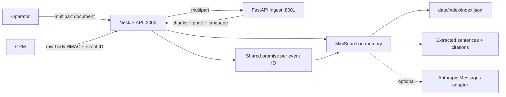

# Insurance Policy Copilot

A local forward-deployed-engineering portfolio project: upload a synthetic insurance policy, retrieve passages, and answer questions with page-level citations. A signed CRM webhook supports idempotent automatic questions. Default extractive answers require no paid services. All sample policies are fictional.



## Install and run

Requires Python 3.12+ and Node 20.19+ (NestJS 11 minimum). No Docker or database is needed. Commands use Windows PowerShell from the repository root. Installation requires network access.

```powershell
cd services/ingest
python -m venv .venv
.venv\Scripts\python -m pip install -r requirements.txt
.venv\Scripts\python -m uvicorn main:app --host 127.0.0.1 --port 8001
```

In a second terminal:

```powershell
cd apps/api
npm.cmd install
npm.cmd run build
$env:CRM_WEBHOOK_SECRET = 'local-demo-only-change-before-client-use'
# Leave ANTHROPIC_API_KEY unset for free extractive answers.
npm.cmd start
```

Defaults: API `PORT=3000`, `INGEST_URL=http://localhost:8001`, `INDEX_PATH=data/index/index.json` relative to the API working directory. Environment variables are inherited from the shell. For saved local configuration, copy `.env.example` to `.env` and use `node --env-file=.env dist/main.js` instead of `npm.cmd start`. Ingest's port is controlled by the uvicorn CLI flag. Never commit secrets.

## Tests

```powershell
cd services/ingest
.venv\Scripts\python -m pytest -q
cd ../../apps/api
npm.cmd test
npm.cmd run build
cd ../..
```

API tests use a temporary index and mocked ingest/LLM calls. Python tests generate their own PDF. No tests call paid APIs.

## Curl walkthrough

In a third terminal from the repository root:

If the default ports are occupied, start ingest with a different `--port`, set API `PORT` and `INGEST_URL` accordingly, and change the base URLs below. Use a separate `INDEX_PATH` for an isolated second instance.

```powershell
$apiBase = 'http://127.0.0.1:3000'
$ingestBase = 'http://127.0.0.1:8001'
curl.exe --fail "$ingestBase/health"
curl.exe --fail "$apiBase/health"
curl.exe --fail -F "doc_id=motor" -F "title=Fictional motor policy" -F "file=@samples/policies/motor.md" "$apiBase/documents"

$utf8 = [System.Text.UTF8Encoding]::new($false)
$askPath = Join-Path $env:TEMP 'policy-copilot-ask.json'
[System.IO.File]::WriteAllText($askPath, '{"question":"What is the windscreen repairs limit?","top_k":3}', $utf8)
curl.exe --fail -H "Content-Type: application/json" --data-binary "@$askPath" "$apiBase/ask"
# Expect EGP 5000 and a motor page 1 citation.

$env:CRM_WEBHOOK_SECRET = 'local-demo-only-change-before-client-use'
$crmPath = Join-Path $env:TEMP 'policy-copilot-crm.json'
[System.IO.File]::WriteAllText($crmPath, '{"event_id":"demo-001","case_id":"fictional-case-001","customer_question":"What is the windscreen repairs limit?"}', $utf8)
$hmac = [System.Security.Cryptography.HMACSHA256]::new($utf8.GetBytes($env:CRM_WEBHOOK_SECRET))
$signature = 'sha256=' + ([System.BitConverter]::ToString($hmac.ComputeHash([System.IO.File]::ReadAllBytes($crmPath))).Replace('-', '').ToLowerInvariant())
$hmac.Dispose()
curl.exe --fail -H "Content-Type: application/json" -H "X-Signature: $signature" --data-binary "@$crmPath" "$apiBase/webhooks/crm"
curl.exe --fail -H "Content-Type: application/json" -H "X-Signature: $signature" --data-binary "@$crmPath" "$apiBase/webhooks/crm"
# CRM responses are HTTP 200 with identical results and one computation.
Remove-Item -LiteralPath $askPath, $crmPath
```

`POST /documents` and `POST /ask` return HTTP 201; successful health/webhook calls return 200. Errors use `{statusCode, error: {message, ...}}`. Invalid signatures return 401 before processing. Questions must be nonblank, at most 2000 characters; `top_k` is an integer from 1 to 10. Document IDs accept letters, numbers, underscore and hyphen.

## End-to-end smoke and eval

With both services running, from the repository root:

```powershell
$env:CRM_WEBHOOK_SECRET = 'local-demo-only-change-before-client-use'
services/ingest/.venv/Scripts/python scripts/smoke.py
services/ingest/.venv/Scripts/python eval/run-eval.py
```

The smoke script loads all five synthetic policies, checks a cited answer and signs/replays a CRM event. Eval runs 19 questions (three Arabic, two unknown), prints retrieval hit rate at k=3, not-found accuracy and average latency, and writes `eval/results.md`. Load all samples first. It checks retrieved document/page, not answer correctness. This small lexical fixture is a regression check, not a general RAG benchmark.

If default ports are already occupied, start ingest with `--port 8002`, set API `PORT=3001`, `INGEST_URL=http://127.0.0.1:8002` and a separate `INDEX_PATH` before starting it. Adjust `$apiBase`/`$ingestBase` in the curl walkthrough and pass `--api-url http://127.0.0.1:3001` to smoke/eval. Leave existing processes running.

Run the complete sample loader, signed CRM smoke test and evaluation from the repository root with both services running:

```powershell
$env:CRM_WEBHOOK_SECRET = 'local-demo-only-change-before-client-use'
services/ingest/.venv/Scripts/python scripts/smoke.py
services/ingest/.venv/Scripts/python eval/run-eval.py
```

Both scripts accept `--api-url http://127.0.0.1:<port>` for an alternate API port. The recorded local verification is in [docs/verification.md](docs/verification.md).

## Design decisions and limits

- Ingest is stateless. PDF text is extracted per page; text/Markdown uses page 1. Sentence-aware chunks are at most 900 characters with up to 120 characters of sentence overlap. Short pages remain short; very long sentences split at 850 characters. A simple Arabic-letter heuristic sets language. Empty/unsupported uploads return 400; uploads above 10 MB return 413. Scanned PDFs require OCR outside this phase.
- MiniSearch provides BM25-style lexical retrieval with Unicode tokenization and basic Arabic normalization. A score floor of 0.2 and a minimum half-query-term overlap reject weak matches after removing stop words. These are heuristics: unsupported questions sharing policy vocabulary may still retrieve passages, and paraphrases may miss. Extractive answers quote matching sentences and append chunk citations.
- The versioned on-disk JSON stores source chunks; MiniSearch is rebuilt on startup. Writes are serialized and atomically replace the snapshot before publishing to memory. Re-ingestion replaces all chunks for a document ID. A corrupt index fails startup. Use one writer process per index directory.
- HMAC covers exact raw bytes and uses constant-time digest comparison. A shared promise is installed synchronously before computation, preventing concurrent duplicate work. Failed computations may retry. First successful payload wins for an event ID. The in-memory result map is unbounded and resets on restart; deduplication is not durable.
- Multi-instance production needs durable event results, Redis `SET NX` leases, completion records and input hashes, plus agreed retention and replay-age controls. Filesystem writes and in-memory locks do not coordinate across instances. See the [client installation playbook](docs/deployment-playbook.md).
- Optional Anthropic Messages uses `claude-sonnet-5-5` as the contract specifies. No key means no LLM calls. With a key, questions and excerpts are sent and successful answers use `mode: llm`; failures return 502. Tests mock this adapter. Live model availability and generated grounding are unverified. Activation requires cost/data-sharing approval.
- Services bind to localhost in this walkthrough. This phase has no user authentication, tenant separation, rate limiting, production monitoring or UI. Do not expose it directly or use real client data. No deployment has been performed.

Selected dependencies are from the contract allowlist. NestJS installs required runtime peers, including `reflect-metadata` and `rxjs`, through npm. The Node lockfile records resolved versions; Python uses bounded ranges. Pin and review the Python environment for a client rollout.
