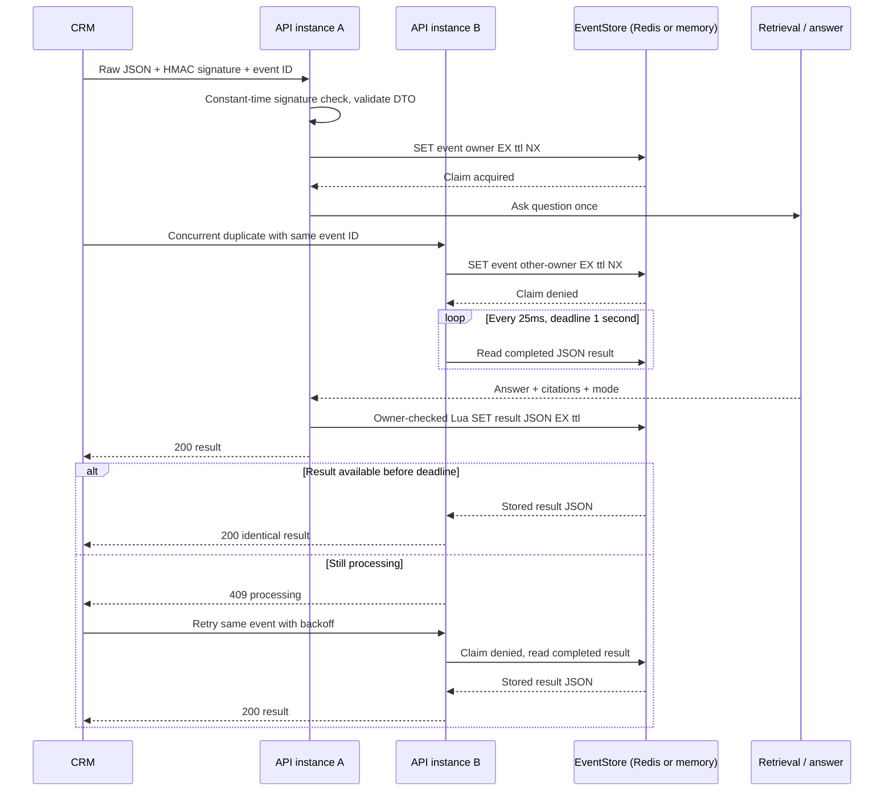

# Architecture

## Components and data flow

The NestJS API owns the static UI, validation, document forwarding, retrieval, answer generation and signed CRM endpoint. FastAPI is stateless: pypdf extracts PDF pages; UTF-8 text uses page 1. Sentence-aware chunks target up to 900 characters with up to 120 characters of overlap; long sentences split at 850 characters. A letter heuristic labels Arabic or English.

MiniSearch indexes text/title after Unicode tokenization and Arabic normalization. Diacritics and tatweel are removed; alef, ya and ta marbuta forms are unified. Common article/preposition prefixes are stripped from tokens longer than three characters. The same tokenizer handles queries, indexing and sentence ranking. English handling is unchanged. Stop words, a score floor and half-query overlap guard against weak matches.

Source chunks are persisted as versioned JSON. Each replacement builds a new index, atomically renames a temporary snapshot, then publishes memory state. Writes serialize within a process. A corrupt snapshot fails startup. One writer per index directory remains required; a shared Redis event store does not solve index replication.

The default answer selects matching source sentences and includes title/page/snippet citations. An optional Anthropic adapter can replace answer generation when explicitly configured. Tests mock this adapter. The UI uses textContent for all API-derived content, reports loading/error/empty states, and sets RTL for Arabic questions or answers.

## CRM delivery and retries

An EventStore abstraction has memory and Redis implementations. `REDIS_URL` chooses Redis; otherwise memory is process-local. The default TTL is seven days, configured by `CRM_EVENT_TTL_SECONDS`, and refreshed on completion. A random owner token guards completion/release using atomic Lua compare operations. Failed computations release only their own claim. A late worker cannot overwrite a newer claim after expiry. Stored results survive API restarts when Redis retains data.

The loser polls a bounded interval, then returns 409 rather than computing a duplicate. A crash without release retains the claim until TTL expiry. A result/claim expiration allows new work. There is no lease renewal or input hash: keep processing shorter than TTL and do not reuse IDs for changed payloads. This is bounded-retention idempotency for a read-only answer operation, not a promise of exactly-once external side effects.

## Runtime boundaries

Compose runs private ingest/Redis and a localhost-published API; healthchecks gate startup and named volumes retain the index and Redis append-only data. The no-Docker launchers use memory by default, accept an externally supplied Redis URL, force extractive mode and load synthetic samples. Neither startup path deploys anything remotely.

The API has raw-body HMAC validation for CRM only. Upload, ask, UI and sample loading have no user authentication. Production needs restricted TLS access, tenant isolation, policy/version review, replay protection, monitoring and approved retention. Application health indicates responsiveness, not dependency readiness or data quality. Unit tests use an in-process Redis fake; real Redis/container execution and browser rendering have separate verification status in `docs/verification.md`.
